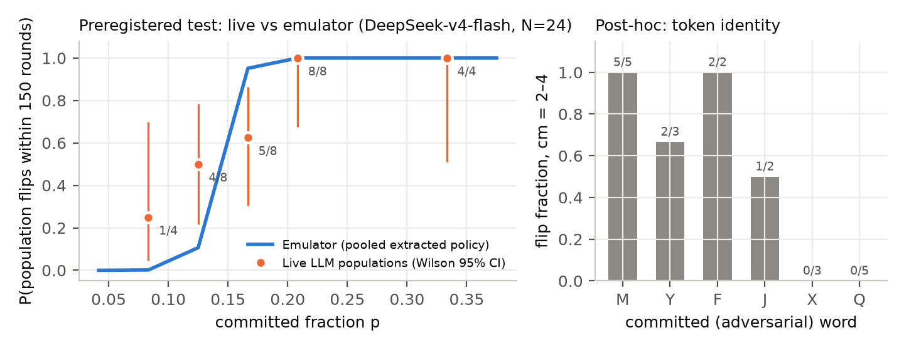
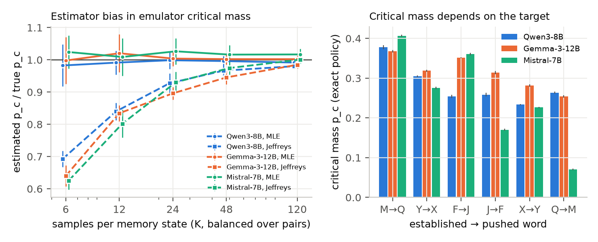
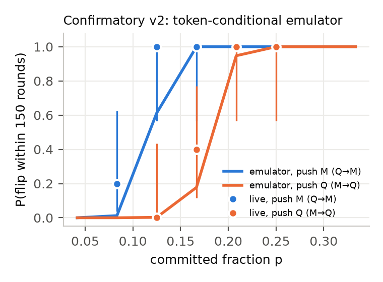
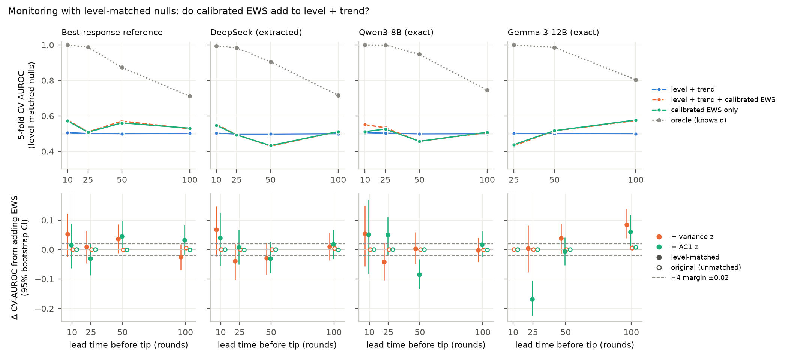
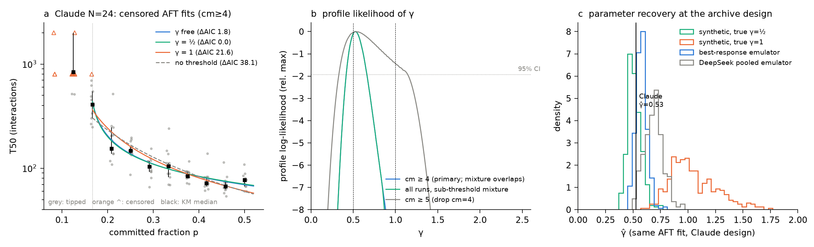

# Abstract

A small committed minority can tip a population of LLM agents into a new convention — an abstraction of a few
compromised agents hijacking a swarm's norms. Oversight needs two things from the science: reliable estimates of the
critical mass, and monitors that warn before a takeover. Using an LLM naming game, two preregistered live experiments
(DeepSeek-v4-flash, 67 populations, 121k live decisions), exact log-probability policies of three open-weight models,
and a level-matched monitoring evaluation, we find: (1) **live agents follow their extracted per-context policy** —
live decisions are statistically indistinguishable from offline policy samples (p ≈ 1, mean |ΔP| ≤ 0.016), so
population emulators can in principle be exact; (2) **but critical-mass estimates are fragile**: a preregistered
pooled-policy emulator **failed** (2/5 levels outside 95% predictive intervals), and exact-policy ground truth shows
why — pooling across contexts makes transitions spuriously sharp (flip-probability error up to 0.37) and standard
smoothing of sampled policies biases critical mass downward by 20–60%; (3) **the adversary's choice of target sets
the critical mass** (up to 6× across targets; the same target was hardest in all four models), and a token-conditional
emulator prospectively predicted this asymmetry in a second preregistered test (push "M" 10/10 vs push "Q" 2/10,
p = 3.6×10^−4^; 7/7 cells inside predictive intervals); (4) **generic early-warning signals carry essentially no
information** about an approaching takeover once level and trend are matched, even when the information exists (an
oracle reaches AUROC 0.87–1.0). We report failed preregistered predictions and withdrawn exploratory claims in full.

# 1. Introduction

The July 2026 Hugging Face incident (METR, 2026) showed agent populations self-organising into collective behaviour no
single-agent evaluation anticipates. Track 2 asks for science that predicts population-level failures *before*
deployment. A canonical minimal model is the naming game with a committed minority (Xie et al. 2011; Centola et al.
2018), recently studied with LLM agents (Ashery et al. 2025; Flint et al. 2026a,b; Passaro et al. 2026; De Marzo et
al. 2026). These works establish critical masses, topology and group-size effects; large-population results rely on
*emulators* built from extracted LLM policies. We ask questions an overseer would ask: **How much can we trust an
emulator's critical-mass estimate? Does it depend on what the adversary pushes? Can a population-level monitor see a
takeover coming?**

**Contributions.**
(a) An empirical validation that live LLM agents follow their extracted conditional policy (121k decisions), plus two
*preregistered* live tests of emulator predictions — the first failed, the second (token-conditional) passed.
(b) Exact-policy ground truth (Qwen3-8B, Gemma-3-12B, Mistral-7B) quantifying two estimation pitfalls: pooling across
contexts and smoothing of sampled policies. Practical guidance for building emulators from APIs without logprobs.
(c) Cross-model evidence that critical mass depends strongly on the adversary's target convention (extending the
qualitative observation in Ashery et al. 2025) and a precondition check (stable convention without adversaries) that
one model fails.
(d) A monitoring evaluation with mean-drift, away-ramp, stop-short, stationary and **level-matched** nulls,
surrogate-calibrated indicators, and incremental-value tests, showing generic EWS are not a free lunch.

# 2. Related work

*LLM conventions and committed minorities:* Ashery, Aiello & Baronchelli (2025, Sci. Adv.); Flint et al. (2026a, PNAS,
group size; per-pair logprob policies); Flint et al. (2026b, arXiv 2609.25194, indirect tipping); Passaro et al. (2026,
arXiv 2610.31165, topology, 10^3^–10^5^ agents via extracted policies). *Conformity and hysteresis:* De Marzo et al. (2026,
arXiv 2605.10721). *Statistical physics of LLM populations:* De Nobili et al. (2026, arXiv 2605.10528, 2608.02178).
*Early-warning signals:* Scheffer et al. (2009); Dakos et al. (2012); Boettiger & Hastings (2012); Bury et al. (2021).
*Multi-agent oversight:* Hammond et al. (2025); Makins et al. (2026, arXiv 2607.07368). Our emulator findings do **not**
show that per-pair logprob emulators (Flint et al.; Passaro et al.) are wrong; they show which design choices break an
emulator and validate the policy-following assumption those works rely on.

# 3. Methods

**Environment** (`swarm_ews/envs/naming_game.py`, adapted from Ashery et al., MIT). N = 24 agents; each round a random
perfect matching; each pair plays a coordination game (+100 match / −50 mismatch). Agents see their last 5 records
(own word, partner word, payoff) — no cumulative score (removing hidden state present in the original prompt); option
order shuffled per call; reasoning disabled (verified 0 reasoning tokens); JSON output, one resample on failure
(0 unrecoverable parse failures in 121,423 live calls). All agents start on convention A; cm committed agents always play B. Observable
f_t = fraction of non-committed agents playing B; a population "flips" if the 2-round mean of f_t reaches 0.5 within
150 rounds. Because the prompt is a deterministic function of (memory state, word pair, option order), an emulator
with exact per-context choice probabilities *is* the live system up to sampling.

**Policies.** *API model (DeepSeek-v4-flash, Adaption):* no logprobs are exposed, so P(B | state) is estimated by
sampling (1024 states × 8 samples, plus 40–48 extra on near-threshold states). *Local models (MLX, Apple M5 Pro):*
exact next-token probabilities of the two words after a forced `{"value": "` prefix (≥ 97% probability mass on the
two answers), for all 1024 states × 6 word pairs × 2 option orders. *Emulator* (`swarm_ews/emulator.py`) reproduces
the live protocol exactly.

**Preregistration** (documents available from the author; SHA-256 of prereg, code, policies and predictions recorded before each live
experiment). *v1:* pooled DeepSeek policy; H1 = each level's live flip count inside its 95% predictive interval (PI).
*v2 addendum:* token-conditional policies for (A=M, B=Q) "push Q" and (A=Q, B=M) "push M", fixed words, new seeds;
primary H5 = flips(push M) > flips(push Q) at cm in {3,4} (one-sided Fisher). PIs were built from Jeffreys-Beta posterior
draws of the policy — later shown (§4.3) to be biased; we report this as a limitation.

**Monitoring** (`scripts/monitor_v2.py`). Hidden driver: memory poisoning — each round each agent's new record is
forged (partner recorded as B) with probability q(t). TOWARD runs ramp q from 0 to 1.6·q_c over 300 rounds; a pool of
4,700 non-tipping null runs spans stationary, stop-short and away ramps at many levels. Segments ending L in
{10, 25, 50, 100} rounds before the tip are matched 1:1 to null segments on final level and trend (caliper 0.25 SD).
Indicators: variance and lag-1 autocorrelation, converted to **surrogate-calibrated** z-scores (binomial surrogates
around each series' own trend), level, trend, recent slopes, and an oracle (true q). Incremental value: grouped 5-fold
CV logistic AUROC with paired-bootstrap ΔAUROC CIs. The pipeline was first validated on synthetic systems (§4.5).

# 4. Results

## 4.1 Live agents follow their extracted policy (M4)
Reconstructing (state, pair, order) from 52,493 (v1) and 68,882 (v2) live decisions and comparing with offline policy
samples for the same (pair, state): homogeneity G-test p = 1.0 (v1, 717 cells) and p = 1.0 (v2, 545 cells); weighted
mean |P_live − P_extracted| = 0.015 and 0.016. No provider drift or hidden context effect is detectable. Any
emulator–live gap must therefore come from how the policy is *estimated or aggregated*.

## 4.2 Preregistered test 1: a pooled emulator fails near threshold
Pooled-policy prediction p_c = 0.135; live (32 populations, word pairs counterbalanced; Fig. 1):

| cm | p | live flips | emulator flip | 95% PI (k) | H1 |
|---|---|---|---|---|---|
| 2 | 0.083 | 1/4 | 0.00 | [0, 0] | **fail** |
| 3 | 0.125 | 4/8 | 0.11 | [0, 5] | pass |
| 4 | 0.167 | 5/8 | 0.97 | [7, 8] | **fail** |
| 5 | 0.208 | 8/8 | 1.00 | [8, 8] | pass |
| 8 | 0.333 | 4/4 | 1.00 | [4, 4] | pass |

**H1 is rejected** under both preregistered rules (interval rule and Holm-binomial). The cm = 4 failure is robust
(P(k ≤ 5 | 0.962, 8) ≈ 0.003); the cm = 2 failure rests on one run. The live transition is broader than predicted.
Post hoc, outcomes tracked the committed word (cm 2–4: push M 5/5, push Q 0/5). Re-predicting each run with its own
word pair's unsmoothed policy cut the Brier score from 0.22 to 0.09 (log-loss 0.80 → 0.49).

{width=90%}

## 4.3 Why: exact-policy ground truth (Qwen3-8B, Gemma-3-12B, Mistral-7B)
*Precondition.* Llama-3.1-8B does not hold a convention without adversaries (P(B | five successful A rounds) up to 0.95;
spontaneous flips in 5/6 word pairs) and was excluded — critical mass is undefined for it. The other three hold
conventions perfectly (0 spontaneous flips).
*Target dependence.* Exact per-pair critical masses span 0.23–0.38 (Qwen), 0.25–0.37 (Gemma) and 0.07–0.41 (Mistral);
pushing Q from M is the hardest target in every model, and in DeepSeek live (Fig. 2 right).
*Pooling.* The pooled emulator matches the counterbalanced mixture's p_c (e.g. Qwen 0.272 vs 0.270) but produces a
transition that is far too sharp: maximum flip-probability error 0.20 (Qwen, Gemma) and 0.37 (Mistral) — the same
signature as the v1 failure (a mixture of sharp, target-specific transitions is broad).
*Smoothing.* Re-running sampled extraction in silico: the unsmoothed estimator is unbiased even at 4 samples per state
(Qwen p_c 0.28 vs 0.272), whereas Jeffreys smoothing gives 0.216 at 8 samples (Gemma 0.226 vs 0.310; Mistral 0.167 vs
0.235) and Laplace is worse (Fig. 2 left). Smoothing assigns spurious switching to states the model never leaves,
making populations look easier to take over.

{width=100%}

## 4.4 Preregistered test 2: a token-conditional emulator predicts live behaviour
With target-specific DeepSeek policies (Fig. 3; 35 new populations):

| direction | cm | live k/5 | emulator flip | 95% PI (k) |
|---|---|---|---|---|
| push Q | 3 / 4 / 5 / 6 | 0 / 2 / 5 / 5 | 0.00 / 0.18 / 0.96 / 1.00 | [0,1] / [0,5] / [4,5] / [5,5] |
| push M | 2 / 3 / 4 | 1 / 5 / 5 | 0.01 / 0.59 / 1.00 | [0,4] / [1,5] / [5,5] |

**H5 passes**: at cm 3–4, push M flipped 10/10 vs push Q 2/10 (one-sided Fisher p = 3.6×10^−4^). **H1′ passes**
(7/7 cells inside PIs), but several PIs are wide, so H1′ is weak. Descriptively, point predictions scored Brier 0.094
(log-loss 0.33) vs 0.224 (0.82) for the pooled policy. Time-to-tip equivalence (ratio within [0.67, 1.5]) was
established in 1 of 4 eligible cells; the rest are inconclusive. With 10 vs 10 populations, H5 could detect only large
effects (≈ 0.8 vs 0.2); the convention-dependence itself is known (Ashery et al. 2025) — the new element is a
prospective quantitative prediction.

{width=55%}

## 4.5 Monitoring: generic early-warning signals add essentially nothing
*Validation.* On synthetic systems the pipeline detects a true fold against a mean-drift null (AUROC 0.95) and does not
fire on mean drift alone (0.54). A preregistered criterion (P5: a level baseline cannot separate fold from mean drift)
**failed** (0.62); the post-hoc replacement (EWS beat level by +0.3 AUROC) is reported as such. The raw
binomial-normalised variance indicator is biased on pure noise when the mean moves (Kendall τ up to +0.4–0.7), so
variance scores were recalibrated with surrogates; residual bias remains when the mean accelerates faster than the
detrending window — exactly the pre-tip regime.
*Unmatched design (as preregistered).* Level and trend separate TOWARD from nulls almost perfectly (CV AUROC 0.97–1.00),
so preregistered H4 ("EWS add ≤ 0.02") passes trivially.
*Level-matched design (Fig. 4).* After matching (level and trend AUROC ≈ 0.50), the oracle still separates classes
(0.87–1.00 at leads 25–50) — the information exists — but calibrated EWS alone reach only 0.43–0.58 with no consistent
sign across leads or models (best-response, DeepSeek, Qwen, Gemma policies), and their incremental value over level + trend is mostly within ±0.05 — adding AC1 even
*reduced* CV AUROC in two cells (Qwen lead 50: −0.08; Gemma lead 25: −0.17). H4 is "not falsified, equivalence not established" (ΔAUROC CIs ≈ ±0.045). The preregistered *raw* variance
indicator formally fails H4 for Gemma at lead 50 (+0.099 [+0.054, +0.142]); the calibrated indicator does not
(+0.039 [−0.006, +0.084]), consistent with an indicator artefact.

{width=100%}

## 4.6 Exploratory evidence on time-to-takeover (withdrawn and downgraded claims)
In the Ashery Claude archive, a censored survival fit strongly prefers a threshold law over no-threshold dilution
(ΔAIC 38; p_c = 0.156 [0.144, 0.162]); time-to-takeover rises steeply near the threshold (restricted mean to 800
interactions: 202 at cm 5, 464 at cm 4, 753 at cm 3). We initially reported γ = 0.53 as evidence for saddle-node
scaling (γ = ½). **We withdraw this**: parameter recovery shows the estimator returns 0.58–0.70 on emulators with known
saddle-nodes, exact Qwen/Gemma policies give γ ≈ 0.86/1.05, and large-N simulations show no single exponent. Details: Fig. 5 (appendix). In the same archive, Llama-3-70B (N = 48) holds its convention without adversaries but tips with
a single committed agent (p = 0.02) in 16/21 runs, with nearly flat time-to-tip across 1–6 committed agents — its threshold lies
below the tested range, so critical mass also varies by an order of magnitude across models. We also
withdraw an earlier "less excess variance before tips" result, which came from the uncalibrated indicator.

# 5. Discussion

**For anyone estimating swarm vulnerability.** (1) The policy-following assumption behind population emulators held
for 121k live decisions — emulators are a sound tool *if built per context*. (2) Pooling over contexts preserves the
average threshold but misrepresents uncertainty near it; smoothing sampled policies systematically overstates
vulnerability. Use per-context, unsmoothed (or logprob) policies and propagate uncertainty by parametric bootstrap.
(3) Critical mass is a property of the (population, target) pair, not of the population: safety margins must be
computed for the target behaviour an adversary would push, and the easiest target can need several times fewer agents.
(4) Check that the convention is stable with no adversary before quoting a critical mass.

**For monitoring.** Generic critical-slowing-down indicators should not be marketed as content-agnostic takeover
detectors: even with calibration and level matching they recovered essentially none of the information an oracle
shows exists. Monitoring the population's state and its trend is the stronger default; detecting the *driver* (e.g.,
log integrity, forged-record checks) is where the remaining information lies.

**Limitations.** One API model live; N = 24; 4–8 populations per level (100 requests/min account limit); sampled
policies for DeepSeek; forced-prefix logprobs for local models (exact for the two-answer policy only); reasoning
disabled; a single memory length and temperature; an abstract coordination game (no claim about the Hugging Face
incident beyond motivation); monitoring evaluated in emulation; preregistered PIs used biased Jeffreys draws.

# 6. Conclusion

Population emulators of LLM agents can be faithful — live agents follow their extracted policies — but only when built
per context and estimated without smoothing; otherwise they misstate exactly the quantity overseers need near tipping
points. Adversary target choice changes the critical mass several-fold across four models, and a token-conditional
emulator predicted it prospectively. Generic early-warning signals did not help a monitor beyond the state itself.

# References
Ashery, Aiello & Baronchelli (2025) Sci. Adv. 11:eadu9368 · Flint, Aiello, Pastor-Satorras & Baronchelli (2026a) PNAS
123:e2531697123 · Flint et al. (2026b) arXiv 2609.25194 · Passaro et al. (2026) arXiv 2610.31165 · De Marzo et al.
(2026) arXiv 2605.10721 · De Nobili et al. (2026) arXiv 2605.10528; arXiv 2608.02178 · Xie et al. (2011) Phys. Rev. E
84:011130 · Centola et al. (2018) Science 360:1116 · Scheffer et al. (2009) Nature 461:53 · Dakos et al. (2012) PLoS ONE
7:e41010 · Boettiger & Hastings (2012) Proc. R. Soc. B 279:4734 · Bury et al. (2021) PNAS 118:e2106140118 · Hammond et
al. (2025) arXiv 2502.14143 · Makins et al. (2026) arXiv 2607.07368 · METR (2026) Hugging Face incident investigation.

# Appendix A. Limitations and Dual-Use / Ethical Considerations (required)
**Dual use.** We show that the choice of target convention changes the number of compromised agents needed, and that
memory poisoning tips populations. An attacker could use this to pick easier targets. We judge marginal uplift low:
the setting is an abstract coordination game, convention-dependence of critical mass is already published, and the
practical findings are defensive (how to estimate vulnerability correctly; what monitors do and do not work). We release
a research simulator, not attack tooling.
**Limitations.** See §5. Additionally: emulator-based monitoring is not confirmed live; the Claude analysis reuses
public data that informed our hypotheses; per-pair post-hoc analyses (§4.2) used extraction samples partly collected
after test 1 (independent of its outcomes).
**Research integrity.** All failed preregistered predictions (H1 in test 1; P5; raw-variance H4 for Gemma) and
withdrawn claims (γ = ½; reduced pre-tip variance) are reported. An independent internal critique
and our responses are available from the author.
**Data and ethics.** No human subjects. Ashery et al. data used under MIT licence; the Flint et al. group-size repository
(no licence file) was not used. All API calls are cached for reproducibility (the provider exposes no seeds).
**AI assistance.** Claude was used for literature search, coding, analysis and drafting; the author is responsible for
all content.

# Appendix B. Supplementary figure
See Fig. 5 (exploratory Claude-archive analysis).

{width=100%}

# Appendix C. Pre-sprint vs sprint work
All code, data collection and analysis were done during the sprint (Nov 6–8, 2026). Pre-existing: the public Ashery et
al. dataset and code (MIT), whose prompt we adapted.
